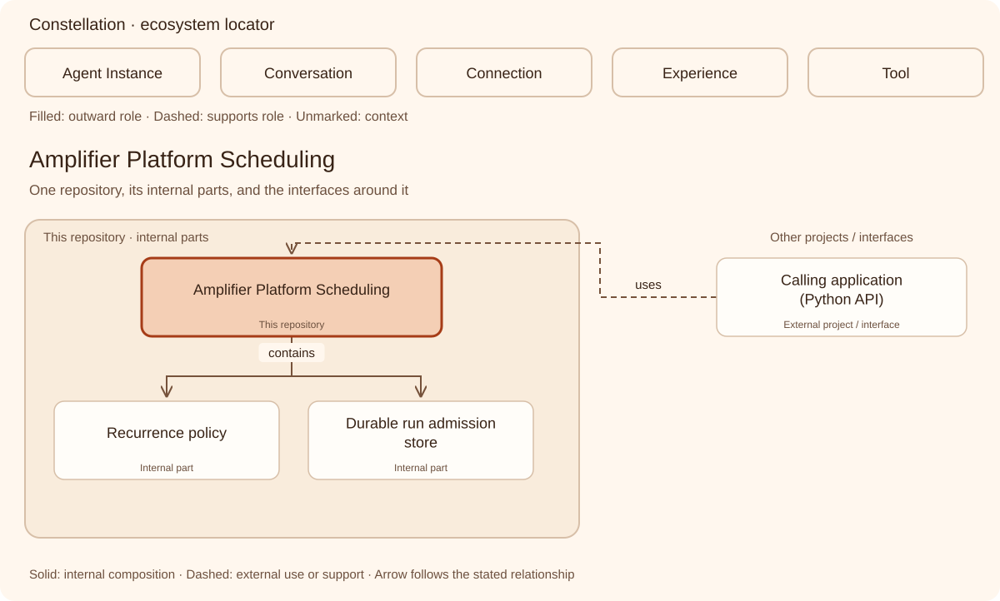

# Reusable scheduling policy and run store

This standard-library package owns recurrence calculation and durable admission
receipts. It has no Amplifier, provider, app, or tool dependency. The host supplies
explicit authorization, task/stop/question gates, input submission, and observed
run outcomes. It never runs model work or grants permission itself.

`normalize`, `next_after`, `preview`, and `due_occurrence` are pure functions over
explicit timestamps and IANA timezones. Once, absolute UTC intervals (minimum
one minute), daily local times, and selected weekdays are supported. Nonexistent
local times are skipped; folds use the first occurrence once. Due identity is
UTC. Preview and execution use the same policy. Missed policy `latest` selects
only the most recent occurrence; `skip` skips occurrences over one minute late.
No catch-up flood is produced after a long shutdown.

`ScheduleStore` owns a separate private SQLite database. Schedule edits use exact
revision CAS and stable command receipts. A database owner lease admits unique
`(schedule_id,due_utc)` runs, with stable IDs and no overlap. Run claims persist
before any external call. Hosts that create a destination first reserve its identity in `creating`. Hosts mark `submitting` before crossing an input
boundary, and must never retry ambiguous handoff. A new owner converts previous
creating/claimed/submitting/accepted/running runs to `unknown` and schedules to visible
`needs_review`, retaining the original input identity and evidence. Unknown runs
require deliberate reconciliation; they cannot release an overlapping new run.

Run history retains the most recent 100 terminal records per schedule by default;
active and unknown rows are never pruned. Idempotency receipts remain durable
rather than being evicted into permission to repeat an old mutation. Methods
perform no network operations; SQLite transactions never enclose provider or
runtime waits. Bounded history means old direct run reads can become unavailable,
not silently replaced by fabricated output.

## Ecosystem map

[Project overview](https://microsoft.github.io/amplifier-constellation/projects/amplifier-platform-scheduling/) ·
[Open the map](https://github.com/bkrabach/amplifier-platform-scheduling/blob/main/docs/ecosystem-map.svg) ·
[Map guide](https://github.com/microsoft/amplifier-constellation/blob/main/docs/ecosystem-maps.md)



<details>
<summary>The wider Constellation ecosystem</summary>


</details>

These maps are generated from the [canonical registry](https://github.com/microsoft/amplifier-constellation/blob/main/docs/ecosystem/registry.json).
Update that source and refresh the local maps together; a map is not a release or compatibility claim.

## Build and test independently

This directory is the complete source project for the `amplifier-scheduling`
Python distribution. It needs Python 3.13 or newer and an IANA timezone database.
Windows installations declare `tzdata`; other platforms normally supply the
database through the operating system. On a minimal system without it, install
`tzdata` in the same Python environment.

From this directory, in an owned development environment:

```sh
uv build
uv venv .venv
uv pip install --python .venv/bin/python "dist/amplifier_scheduling-0.1.1-py3-none-any.whl[test]"
.venv/bin/python -m pytest -q tests
```

On Windows, use `.venv\Scripts\python.exe` for the interpreter paths. The wheel
contains only this library and its distribution metadata; the source archive also
contains its policy/store tests. Those tests exercise DST gaps/folds, missed
runs, owner changes, unknown outcomes, revision checks, command idempotency and
retention using temporary SQLite databases. They require no app, native runtime,
provider, account, network service or sibling checkout. To check an installed
wheel, run these tests from a separate directory containing only the test file;
do not add a source checkout to `PYTHONPATH`.

## Ownership and delivery

This history-preserving project is prepared as the public standalone author home
at `bkrabach/amplifier-platform-scheduling`, with a later transfer to Microsoft
planned. [PROVENANCE.json](PROVENANCE.json) maps the original Unified commits,
including the runtime and tests before their move into `components/scheduling`.
The MIT license and original attribution remain intact. Repository hosting does
not rename the `amplifier-scheduling` distribution or `amplifier_scheduling` import.

The host still owns authorization, Stop handling, task and execution admission,
and browser integration. The library adds no scheduler process or migration.
Its runtime and five tests are unchanged by this import. Authoring handoff and
Unified's artifact selection are separately reviewed changes; do not maintain
competing authored copies after the handoff.

Use a separate environment for this distribution. Do not install it alongside
`amplifier-unified`: Unified currently owns its selected installed package files.
Scheduling is not independently replaceable with pip in that prefix.

## Unified's current artifact selection

The [Unified selection record](https://github.com/microsoft/amplifier-unified/blob/main/components/scheduling.source.json)
names its selected wheel and the exact source for it. Version 0.1.1 adds
`ScheduleStore.renew(now)` for a host awaiting asynchronous work. It returns
false if the lease is missing, expired, or held by another owner.

Unified's `components/scheduling-delivery/` is a generated snapshot of the selected
wheel runtime and license. Its `components/scheduling.source.json` binds the
artifact, producer source, hashes and runtime requirements. Normal wheel, source
archive and editable builds verify the selected snapshot offline. The source
archive carries the delivery and build inputs, so rebuilding requires neither
this repository nor Git or network access.

Creating this public source home, editing it, or building a wheel does not change
Unified's default. A future release and consumer selection must retain exact
artifact/source provenance, Windows timezone requirements, and the sole installed
owner. Existing schedule databases, run identities and uncertain outcomes keep
their authority; source handoff never permits replay. App staging and rollback
continue through Unified's ordinary activation rules.

## Continuous integration and publication

The **Scheduling package** workflow builds one wheel and source archive, then
runs the same policy/store tests against that installed wheel outside the checkout on
Linux and Windows. Pushes and PRs upload qualification artifacts. The normal
publication workflow accepts an exact merged revision and an explicit publish request.
The build/test commands above are
the ordinary local entrypoint and need no Unified, Core, Foundation or sibling
checkout.

Before publishing from this repository, coordinate the next version and release source receipt
with its consumers. Original published tags and bytes must remain unchanged.
A later transfer of this repository should preserve Git history and releases;
consumer selection changes remain explicit and reviewable.

## Contributing

> [!NOTE]
> This project is not currently accepting external contributions, but we're actively working toward opening this up. We value community input and look forward to collaborating in the future. For now, feel free to fork and experiment!

Most contributions require you to agree to a
Contributor License Agreement (CLA) declaring that you have the right to, and actually do, grant us
the rights to use your contribution. For details, visit [Contributor License Agreements](https://cla.opensource.microsoft.com).

The Microsoft source contribution requirements remain applicable to changes
intended for transfer upstream. The temporary personal repository does not claim
that a Microsoft CLA bot or other organization automation is already configured.

This project has adopted the [Microsoft Open Source Code of Conduct](https://opensource.microsoft.com/codeofconduct/).
For more information see the [Code of Conduct FAQ](https://opensource.microsoft.com/codeofconduct/faq/) or
contact [opencode@microsoft.com](mailto:opencode@microsoft.com) with any additional questions or comments.

## Trademarks

This project may contain trademarks or logos for projects, products, or services. Authorized use of Microsoft
trademarks or logos is subject to and must follow
[Microsoft's Trademark & Brand Guidelines](https://www.microsoft.com/legal/intellectualproperty/trademarks/usage/general).
Use of Microsoft trademarks or logos in modified versions of this project must not cause confusion or imply Microsoft sponsorship.
Any use of third-party trademarks or logos are subject to those third-party's policies.

If a host detects a configuration change before starting a due occurrence,
`ScheduleStore.block_due` records the occurrence and marks its schedule for
review in one transaction. It requires the current lease and the exact schedule
revision that the host checked. A blocked occurrence uses the existing terminal
`skipped` phase, carries `blockedBeforeStart` and the host's redacted reason,
and never enters input recovery. A new scheduler owner can complete a pending
notification decision for that same occurrence. If the saved missed-run policy
already skips the occurrence, it keeps its ordinary skipped receipt. A recurring
schedule still enters review for future work. A one-time schedule is complete.

## Immutable release artifacts

The repository-root producer is `scripts/release.py`. Ordinary pushes and pull
requests check publication safety, build the package, and run its installed tests
on Linux and Windows. Publication is a separate manual **Scheduling package**
workflow run on `main`: supply a full merged commit SHA and explicitly enable
`publish`. The workflow publishes only the original artifacts that passed those
checks; it does not choose or increment a version. Review the project version
before requesting a release. This change does not publish a release itself.

Each release has four assets: `amplifier_scheduling-V-py3-none-any.whl`,
`amplifier_scheduling-V.tar.gz`, `scheduling-source.json`, and `SHA256SUMS`.
The schema-1 receipt explicitly identifies `component: scheduling`, this
repository, `subdirectory: .`, and the exact commit/root tree. Its `sourceFiles`
map covers the package metadata, README, license, manifest, provenance and
conduct/security/support files, every `amplifier_scheduling/` file, and the
standalone `tests/`. Each input is verified in the sdist, and runtime files are
verified in the wheel. Repository workflows, `scripts/`, and `tests_release/`
are bound by the full Git tree rather than shipped as package inputs.

The producer refuses conflicting tags or asset bytes and never overwrites them.
It reads an existing draft by its exact ID, including drafts hidden from the tag
endpoint, and uploads only missing assets. A failed or cancelled request can have
completed remotely: inspect its saved state and retain the original four assets.
An explicit rerun with those same assets reconciles that state; the producer does
not automatically retry an uncertain mutation or rebuild missing published bytes.
Completed releases are verified without mutation. Releases are not promoted through
GitHub's `latest` channel; consumers select an explicit tag and receipt.

The reconciliation controls originate from Unified's reviewed component producer
at `792fa1c550101eb00958a05dadfc51017e86f7ff`. Scheduling's future producer is owned
here. Existing Unified-produced releases and their source paths remain immutable.
Unified's consumer cutover and retirement of its editable Scheduling author copy
are separate reviewed work; this workflow does not change its selected artifact.
Until that cutover, do not independently release competing Scheduling changes from
both repositories. Other Unified component producers remain with their own owners.
